<p align="center">
  
</p>

<h1 align="center">group-place</h1>

<p align="center">
  A places diary for friend groups: collect the places you want to go together, and after every visit leave your own rating and review.
</p>

<p align="center"><a href="README.md">한국어</a> · <b>English</b></p>

<p align="center">
  
  
  
  
  
</p>

<p align="center">
  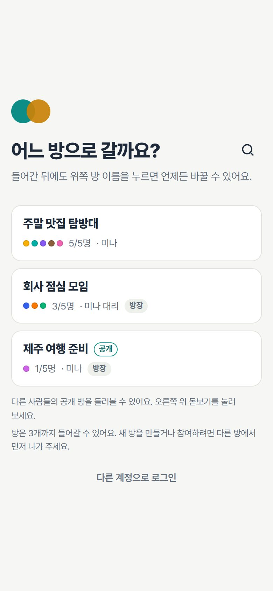
  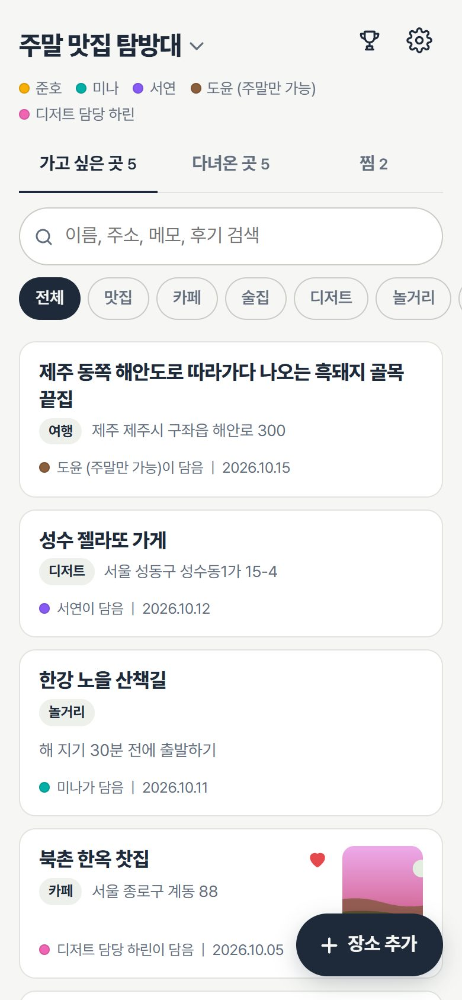
  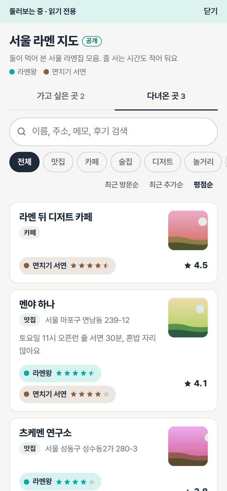
  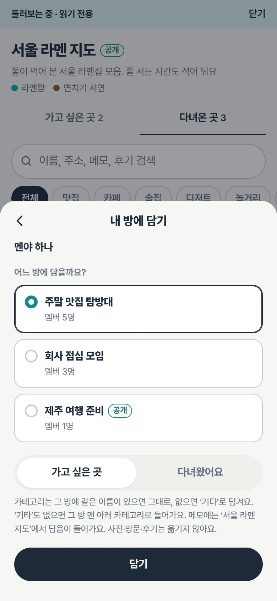
</p>

> The UI is in Korean. Screenshots use sample data; the photos are generated examples and contain no real user information.

## v0.3.1

Deleted records disappear from active views immediately and remain in private trash for 72 hours before server cleanup.
Database and photo backups run on the home server at 08:30 and 18:30 Asia/Seoul. This version also ports map sharing,
local drafts, duplicate and cross-tab search hints, and visit-entry improvements from the original app v2.0.0.
Run **`maintenance.sql` after `stability.sql`, before deploying** ([upgrade, backup and rollback](docs/release-v0.3.1.md), Korean).

## v0.2.3 stability update

The app is in a small colleague test. This update guards saves across room switches, warns about duplicate places,
retries failed thumbnails, enforces the ten-photo limit in the database, saves visits and reviews atomically,
and checks configured features through `/readyz` before accepting a deployment.
Run **`supabase/stability.sql` before deploying** ([upgrade and rollback](docs/release-v0.2.3.md), Korean).
Favorites stay for now, with removal planned later. Password recovery is deferred until a future email system ([future ideas](docs/future-ideas.md), Korean).

## New in v0.2.0: public rooms

- **Public rooms**: when creating a room, choose private or public. The choice cannot be changed later. Think of a public room as "our map worth showing off", e.g. a city's best ramen spots.
- **Browse**: the 🔍 button on the room picker, the room switcher sheet and the start screen opens a list of other people's public rooms, which you can view **read-only** (signed-in users only for now).
- **Copy to my room** (내 방에 담기): save a place you like into one of your rooms; it lands in "want to go" (가고 싶은 곳) by default.
- **Regenerate invite code**: a room owner can create a new invite code from the room settings (내 정보); the old code stops working immediately.

<p align="center">
  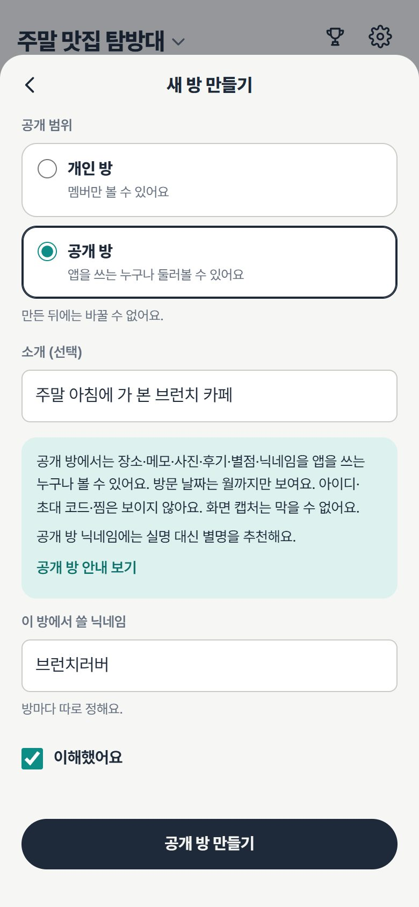
  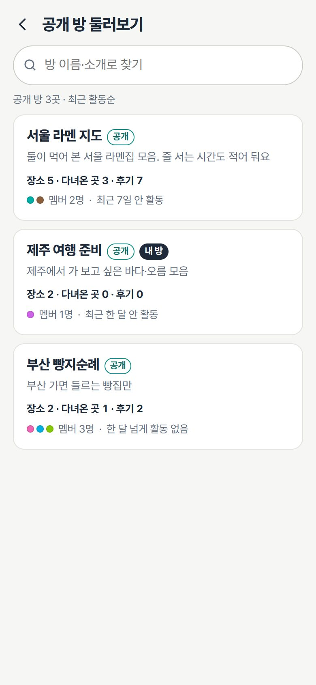
  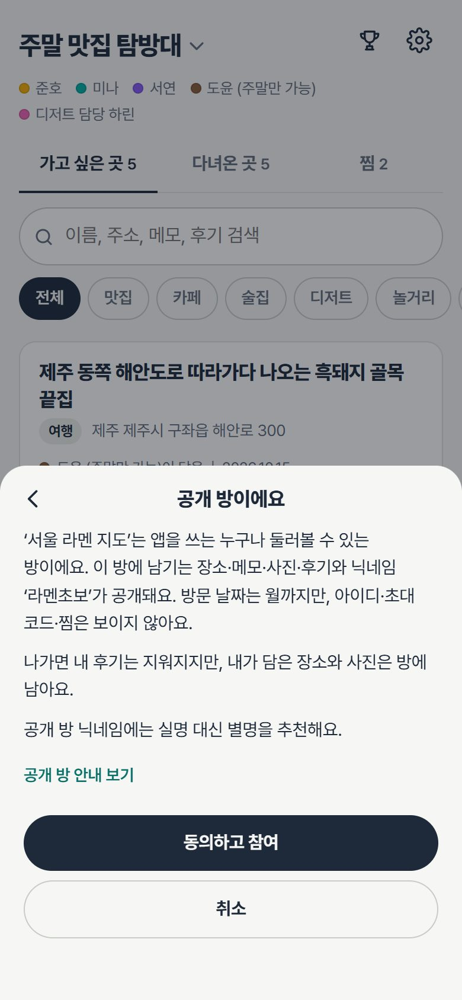
  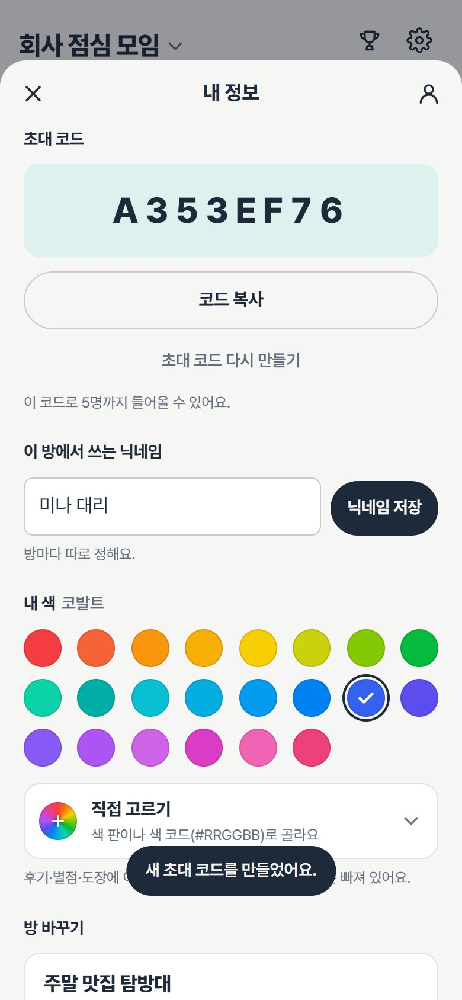
</p>

| Visible in a public room | Never visible |
|---|---|
| Places, categories, addresses, map links, the shared memo, photos (mostly thumbnails), the **month** of each visit, ratings and reviews, nicknames | Login IDs, invite codes, favorites, exact dates, world cup records |

Limits: each person can own one public room, create at most one every 7 days (deleted rooms count), and there are at most 30 public rooms in total. Joining a public room, or signing up with its invite code, requires reading and accepting a notice.

## Features

**Rooms (groups)**
- Up to 5 members per room; a person can be in up to 3 rooms. After signing in you pick a room; tapping the **room name ⌄** at the top lets anyone switch rooms, create a new one or join with a code.
- The invite code is shown on the main screen until the first member joins; after that every member can see it in the room settings. Joining is blocked only while the room has 5 members.
- The room name is set at creation and only the owner can rename it. Leaving is at the bottom of the room settings and deletes your reviews and world cup records. If the owner leaves, the earliest member becomes owner; when the last member leaves, the room is deleted.

**Member colors**
- 24 bright colors in rainbow order; a random unused color is assigned when you join, and you can change it.
- **Custom color** (직접 고르기): pick any color with a color picker or a hex code (#RRGGBB). Colors almost identical to another member's are rejected; similar ones get a warning.

**Records**
- Places: name, category, map link, address, shared memo, up to 10 photos. Pasting a Naver Maps share text or a Google Maps link fills in the name and address.
- Three lists (want to go / visited / favorites), search with a clear (✕) button, category filters and sorting.
- Every visit has a date and a rating (0.5 steps) and review per member. A "place world cup" picks your favorite visited place, stamped in each member's color.

**Accounts**
- Username + password, no email. Sign up with a one-time admin code (`W-XXXX-XXXX`) or a room's 8-character invite code. Wrong codes are limited to 5 per hour per network (successful attempts don't count).
- Password change and sign-out live in a separate account screen (계정 설정). Dark mode; add it to the home screen to use it like an app.

<p align="center">
  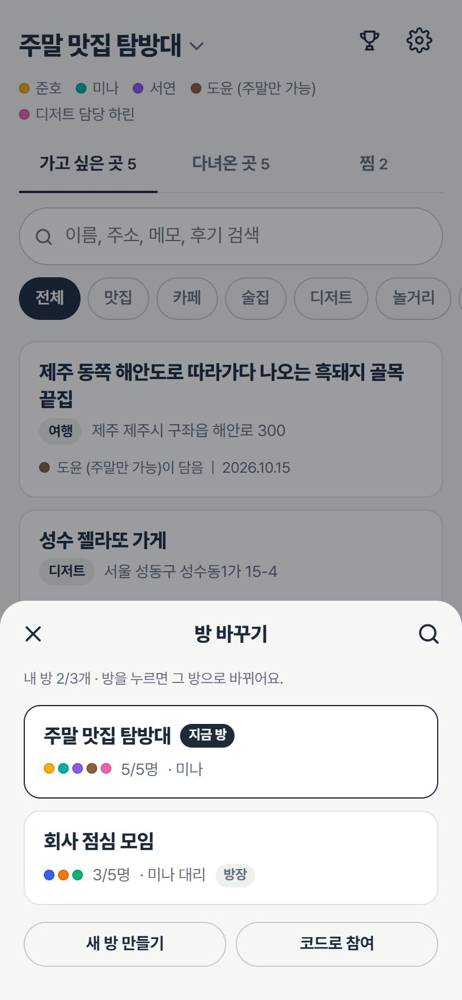
  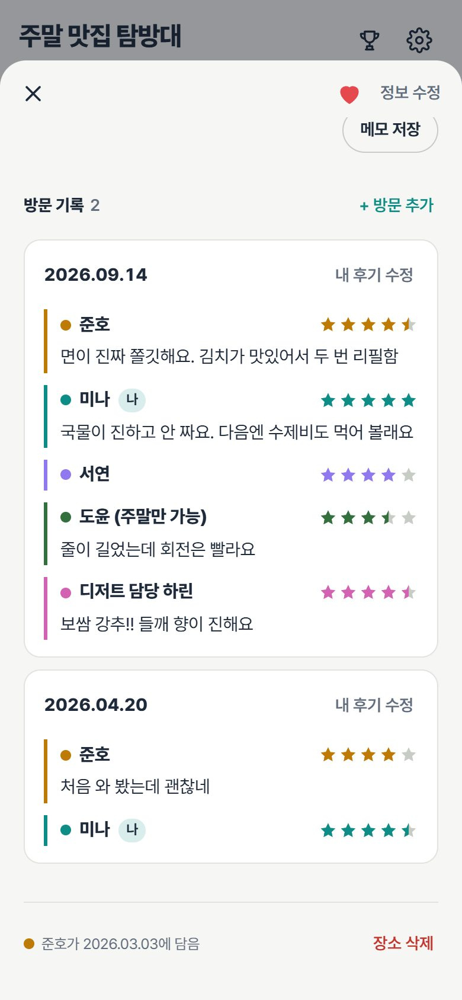
  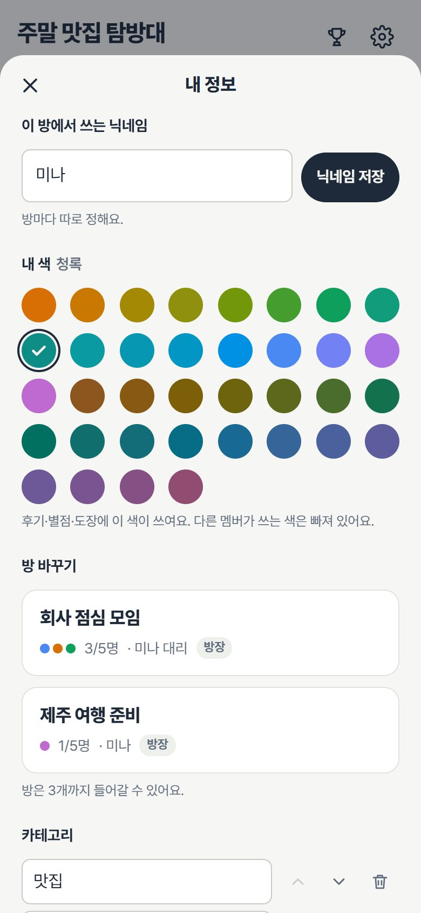
  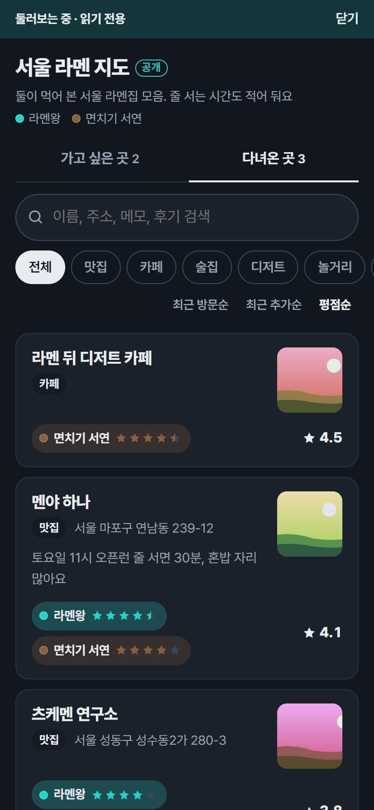
</p>

## Promo video

<a href="promo/promo-30s.mp4">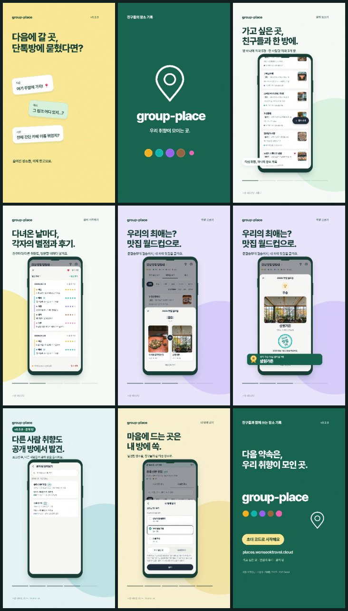</a>

30-second vertical video: [promo/promo-30s.mp4](promo/promo-30s.mp4), recorded from the real app with sample data (before the group features).

## Architecture

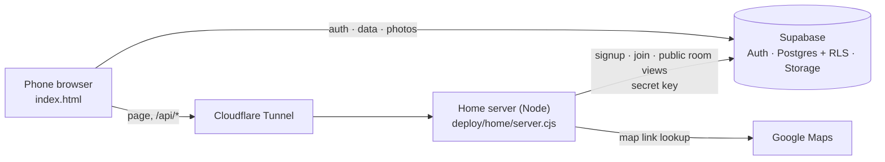

| Area | Files | Role |
|---|---|---|
| Client | `index.html` | The whole app (vanilla JS, supabase-js v2 from a CDN). The Supabase URL/key are placeholders the server fills in when serving the page |
| Server | `deploy/home/server.cjs` | Serves an allowlist of files from memory and injects settings; listens on 127.0.0.1 only |
| Signup | `deploy/home/signup.cjs` | `POST /api/signup`, `POST /api/join` (consent check for public rooms). The secret key lives only on this server |
| Public rooms | `deploy/home/public.cjs` | `GET /api/public/rooms…` (signed-in users only; allowlist filter, cache, rate limits, daily photo budgets); photos are relayed by the server (`/api/public/img`) so storage headers never reveal upload times and `/r/<public key>`. Enabled only with `PUBLIC_ROOMS=on` |
| Maps | `api/place.js` | Google Maps link → place name and address (signed-in users only) |
| Database | `supabase/schema.sql` → `friends-keepalive.sql` → `friends-signup.sql` → `groups.sql` → `colors.sql` → `public.sql` | Tables, functions, grants, RLS, photo storage, multi-room rules, member colors, public rooms. Run in this order (roll back in reverse: `public_rollback.sql` → `colors_rollback.sql` → `groups_rollback.sql`) |
| Stability SQL | `supabase/stability.sql`, `stability_rollback.sql` | Required after `public.sql`: database photo limit and atomic visit/review saves. roll it back before `public_rollback.sql` |
| Deploy | `deploy/home/install.sh`, `deploy.ps1`, `*.service`, `*.timer` | One release per commit, automatic rollback on a failed health check, a daily keepalive for the free Supabase project |

Design docs (Korean): [groups](docs/groups-design.md) · [public rooms](docs/public-rooms-design.md) · [public room ideation](docs/ideation-public-rooms.md) · [plan and decisions](docs/plan.md)

Latest changes and deferred decisions (Korean): [V0.2.3 upgrade and rollback](docs/release-v0.2.3.md) · [future ideas and backup options](docs/future-ideas.md)

## Self-hosting

1. **Supabase**: create a project and run the `supabase/` files above one by one in the SQL Editor (`schema.sql` → … → `public.sql` → `stability.sql`). Under Authentication, **turn off "Allow new users to sign up"** (accounts are created by the server through the admin API after it checks an invite code). Set the Site URL to your app's address.
2. **Server** (Ubuntu, Node 20+), from the repository root:
   ```powershell
   pwsh -File deploy/home/deploy.ps1 -Target <ssh target> -SupabaseUrl https://<project id>.supabase.co -SupabaseKey sb_publishable_... -PublicOrigin https://<app address> -LoginIdDomain id.<your domain>
   ```
   `install.sh` unpacks the release into `/srv/our-places/releases/<commit>` and starts the service on 127.0.0.1:8090. Later deploys only need `-Target`; settings are kept.
3. **Enable signup**: enter the Supabase secret key on the server (hidden input):
   ```bash
   ssh -t <ssh target> "sudo bash /srv/our-places/current/deploy/home/set-secret.sh"
   ```
4. **Expose it**: point a reverse proxy such as a Cloudflare Tunnel at `http://127.0.0.1:8090`.
5. **Signup codes**: `ssh <ssh target> "sudo bash /srv/our-places/current/deploy/home/invite.sh new <note>"`
6. **Public rooms (optional)**: add `PUBLIC_ROOMS=on` to `/etc/our-places/env` and run `sudo systemctl restart our-places` (off by default; `PUBLIC_PHOTOS=off` hides photos while browsing). `deploy/home/public.sh` (list / hide / show) hides a room from the browse list. For upgrading an existing project, see [public rooms design §11](docs/public-rooms-design.md).

> The service and path names on the server (`our-places`, `/srv/our-places`, `/etc/our-places`) match the currently running server and will be renamed to `group-place` later.

## Security

- Only the **publishable key** reaches the browser. The secret key lives only in a root-only settings file on the server, never in the repository, the page, logs or command-line arguments.
- Row-level security (RLS) decides who can read what. Public rooms do not widen RLS: the server calls service-role-only functions and re-packs the result through an allowlist.
- Signup and joining go through the server, which checks codes, attempt limits and public-room consent.
- The server refuses to start with empty or placeholder settings, or when pointed at a project it must not use.
- Please report vulnerabilities privately as described in [SECURITY.md](SECURITY.md).

## Development

```bash
node --test deploy/home/*.test.cjs          # signup, join, public APIs, photo relay and readiness (fake Supabase)
cd dev/sqltest && npm install && npm test   # PGlite grants, limits, atomic saves and client delay/failure regression tests
node dev/mock/serve.mjs                     # run the UI against a fake Supabase (dev/mock/shoot.py takes screenshots and checks the read-only view)
bash scripts/leak-check.sh                  # pre-commit check for secrets and values of other deployments
git config core.hooksPath .githooks         # run leak-check on every commit
```

Build numbers look like `vVERSION-YYMMDD-xxxxx` with five random hex characters (e.g. `v0.2.3-261023-8b7c2`, shown at the bottom of the account screen).

## Roadmap

- Let anyone (not only signed-in users) view public rooms — see "누구나 보기로 넓히려면" in [public rooms design §10](docs/public-rooms-design.md): re-consent, privacy policy, contact and reporting, rate limits and caching
- App name and icon for groups; rename the server service and paths
- Thumbnails for existing photos, account deletion, terms and privacy policy, an Android app (TWA)

## Relationship to the original project

group-place started from a private two-person places diary and is now a **separate project**: source code and databases are fully separated and versions are numbered independently. Improvements from the original app may be ported here after review, but nothing from this repository flows back.

## License

Not chosen yet. Until a license is added, copying or redistributing requires the author's permission.
