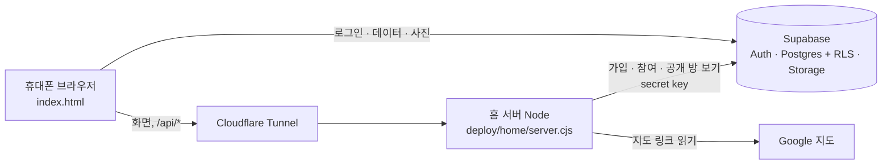

<p align="center">
  
</p>

<h1 align="center">group-place</h1>

<p align="center">
  친구들과 함께 가고 싶은 곳을 모으고, 다녀온 곳엔 방문할 때마다 각자 별점과 후기를 남기는 장소 기록 웹앱
</p>

<p align="center"><b>한국어</b> · <a href="README.en.md">English</a></p>

<p align="center">
  
  
  
  
  
</p>

<p align="center">
  
  
  
  
</p>

> 화면은 예시 데이터로 찍었습니다. 사진은 예시용으로 생성한 이미지이고, 실제 사용자 정보는 들어 있지 않습니다.

## v0.3.1

삭제한 기록은 사용자 화면에서 바로 사라지고 서버 비공개 보관함에 3일 보관한 뒤 정리합니다.
서버 PC에 DB·사진을 매일 08:30 / 18:30(한국 시간) 백업합니다. 원본 앱 v2.0.0의 지도 공유 받기,
초안 복원, 중복·다른 탭 검색 안내, 방문 입력 개선도 반영했습니다.
기존 프로젝트는 **`stability.sql` 다음 `maintenance.sql` 실행 후 배포**하세요([적용·백업·되돌리기](docs/release-v0.3.1.md)).

## v0.2.3 안정화

소규모 동료 테스트 중입니다. 저장 도중 방 전환 보호, 일반 장소 추가 시 중복 확인, 썸네일 실패 후 재시도,
사진 10장 DB 제한, 같은 날 방문·후기의 원자적 저장, 배포 준비 상태(`/readyz`) 확인을 보완했습니다.
기존 프로젝트는 **`supabase/stability.sql`을 먼저 실행한 뒤 배포**하세요([적용·되돌리기](docs/release-v0.2.3.md)).
찜은 현재 유지하며 향후 제거 방향입니다. 비밀번호 찾기는 추후 메일 시스템 도입 시 함께 검토합니다([향후 아이디어](docs/future-ideas.md)).

## v0.2.0 새로 생긴 것: 공개 방

- **공개 방 만들기**: 방을 만들 때 개인/공개를 고릅니다(만든 뒤에는 바꿀 수 없음). "자랑하고 싶은 우리 지도" 같은 목록을 공개 방으로 만들어 보세요.
- **둘러보기**: 방 고르기 화면, 방 바꾸기 시트, 시작하기 화면의 🔍로 다른 사람들의 공개 방을 찾아 **읽기 전용**으로 봅니다(지금은 로그인한 사용자만).
- **내 방에 담기**: 마음에 드는 장소를 내 방 중 하나에 담습니다. 기본은 "가고 싶은 곳"입니다.
- **초대 코드 다시 만들기**: 방장은 내 정보에서 새 초대 코드를 만들 수 있고, 예전 코드는 바로 못 쓰게 됩니다.

<p align="center">
  
  
  
  
</p>

| 공개 방에서 보이는 것 | 보이지 않는 것 |
|---|---|
| 장소·카테고리·주소·지도 링크, 함께 쓰는 메모, 사진(썸네일 중심), 방문한 **달**, 별점·후기, 닉네임 | 아이디, 초대 코드, 찜, 정확한 날짜, 월드컵 기록 |

공개 방은 한 사람이 방장인 방 1개까지, 7일에 1개(지운 방 포함), 전체 30개까지입니다. 공개 방에 참여하거나 그 방 코드로 가입할 때는 안내를 읽고 동의해야 합니다.

## 지금 되는 것

**방(그룹)**
- 방 하나에 최대 5명, 한 사람은 최대 3개 방까지. 로그인하면 방을 고르고, 메인 맨 위 **방 이름 ⌄**를 누르면 누구나 방을 바꾸거나 새로 만들고 코드로 참여합니다.
- 초대 코드는 첫 멤버가 들어올 때까지 메인에 보이고, 그 뒤로는 멤버 모두가 내 정보에서 봅니다. 5명이 차 있을 때만 참여가 막힙니다.
- 방 이름은 만들 때 정하고 방장만 바꿉니다. 나가기는 내 정보 맨 아래에 있고, 내 후기와 월드컵 기록이 지워집니다. 방장이 나가면 가장 먼저 들어온 멤버가 방장이 되고, 마지막 한 명이 나가면 방이 지워집니다.

**멤버 색**
- 화사한 무지개 24색 중 방 안에서 겹치지 않게 처음엔 무작위로 정해지고, 내 정보에서 바꿉니다.
- **직접 고르기**로 색 판이나 색 코드(#RRGGBB)로 아무 색이나 정합니다. 다른 멤버 색과 거의 같으면 막고, 비슷하면 알려 줍니다.

**기록**
- 장소: 이름, 카테고리, 지도 링크, 주소, 함께 쓰는 메모, 사진 최대 10장. 네이버 지도 공유 문구나 구글 지도 링크를 붙여넣으면 이름·주소가 자동으로 채워집니다.
- 세 가지 목록(가고 싶은 곳 / 다녀온 곳 / 찜), 검색(✕로 바로 지우기)과 카테고리 필터, 정렬.
- 방문마다 날짜와 멤버별 별점(0.5점 단위)·후기. 장소 월드컵으로 다녀온 곳 중 최고의 장소를 뽑고, 각자 고른 1위에 그 사람 색 도장이 찍힙니다.

**계정**
- 아이디 + 비밀번호 로그인(메일 없음). 관리자가 만든 1회용 가입 코드(`W-XXXX-XXXX`)나 방의 8자리 초대 코드로 가입합니다. 틀린 코드는 접속한 곳마다 시간당 5회까지입니다(성공은 세지 않음).
- 비밀번호 변경과 로그아웃은 별도 **계정 설정** 화면에 있습니다. 다크 모드를 지원하고, 홈 화면에 추가하면 앱처럼 열립니다.

<p align="center">
  
  
  
  
</p>

## 홍보 영상

<a href="promo/promo-30s.mp4"></a>

30초 세로 영상(v0.2.0): [promo/promo-30s.mp4](promo/promo-30s.mp4). 실제 앱 화면을 예시 데이터로 녹화했습니다(친구 방, 별점·후기, 맛집 월드컵, 공개 방, 내 방에 담기). 사진: 비짓강남 · 서울시 · 미쉐린 가이드 · Visit Seoul.

## 구성



| 영역 | 파일 | 하는 일 |
|---|---|---|
| 화면 | `index.html` | 앱 전체(바닐라 JS, supabase-js v2를 CDN으로). 주소·공개 키 자리는 비워 두고 서버가 보낼 때 채움 |
| 서버 | `deploy/home/server.cjs` | 정해진 파일만 메모리에서 보내고, 설정값을 화면에 넣음. 127.0.0.1에서만 받음 |
| 가입 | `deploy/home/signup.cjs` | `POST /api/signup`, `POST /api/join`(공개 방이면 동의 확인). secret key는 이 서버에만 있음 |
| 공개 방 | `deploy/home/public.cjs` | `GET /api/public/rooms…`(로그인한 사람만, 허용 목록 필터·캐시·횟수 제한·사진 하루 한도), 사진은 서버가 받아 넘김(`/api/public/img`, 저장소 헤더의 업로드 시각을 버림), `/r/<공개 키>`. `PUBLIC_ROOMS=on`일 때만 켬 |
| 지도 | `api/place.js` | 구글 지도 링크 → 장소 이름·주소 (로그인한 사람만) |
| DB | `supabase/schema.sql` → `friends-keepalive.sql` → `friends-signup.sql` → `groups.sql` → `colors.sql` → `public.sql` | 표, 함수, 권한, RLS, 사진 저장소, 여러 방·5명 규칙, 멤버 색, 공개 방. 순서대로 실행(되돌리기는 거꾸로: `public_rollback.sql` → `colors_rollback.sql` → `groups_rollback.sql`) |
| 안정화 DB | `supabase/stability.sql`, `stability_rollback.sql` | `public.sql` 이후 필수. 사진 10장 제한·방문/후기 저장 함수. `public_rollback.sql` 전에는 이것부터 되돌림 |
| 배포 | `deploy/home/install.sh`, `deploy.ps1`, `*.service`, `*.timer` | 커밋 단위 릴리스, 실패하면 이전 릴리스로 되돌림, 하루 한 번 무료 프로젝트 깨우기 |

설계 문서: [그룹 기능](docs/groups-design.md) · [공개 방](docs/public-rooms-design.md) · [공개 방 아이디어](docs/ideation-public-rooms.md) · [계획과 결정](docs/plan.md)

최신 변경과 보류 결정: [V0.2.3 적용·되돌리기](docs/release-v0.2.3.md) · [향후 아이디어·백업 비교](docs/future-ideas.md)

## 직접 설치하기

1. **Supabase**: 새 프로젝트를 만들고 SQL Editor에서 `supabase/` 파일을 위 순서대로 하나씩 실행합니다(`schema.sql` → … → `public.sql` → `stability.sql`). Authentication에서 **Allow new users to sign up은 끕니다**(가입은 서버가 초대 코드를 확인한 뒤 관리자 API로 만듭니다). Site URL에는 앱 주소를 넣습니다.
2. **서버**(Ubuntu, Node 20+): 저장소 맨 위 폴더에서
   ```powershell
   pwsh -File deploy/home/deploy.ps1 -Target <ssh 대상> -SupabaseUrl https://<프로젝트 ID>.supabase.co -SupabaseKey sb_publishable_... -PublicOrigin https://<앱 주소> -LoginIdDomain id.<도메인>
   ```
   `install.sh`가 릴리스를 `/srv/our-places/releases/<커밋>`에 풀고 서비스(127.0.0.1:8090)를 시작합니다. 다음 배포부터는 `-Target`만 넣으면 설정이 유지됩니다.
3. **가입 켜기**: Supabase의 secret key를 서버에서 숨김 입력으로 넣습니다.
   ```bash
   ssh -t <ssh 대상> "sudo bash /srv/our-places/current/deploy/home/set-secret.sh"
   ```
4. **공개**: Cloudflare Tunnel 같은 리버스 프록시로 `http://127.0.0.1:8090`을 원하는 주소에 연결합니다.
5. **가입 코드**: `ssh <ssh 대상> "sudo bash /srv/our-places/current/deploy/home/invite.sh new <메모>"`
6. **공개 방 켜기(선택)**: 서버 설정 파일 `/etc/our-places/env`에 `PUBLIC_ROOMS=on`을 넣고 `sudo systemctl restart our-places`(기본은 꺼짐, 둘러보기 사진만 끄려면 `PUBLIC_PHOTOS=off`). 둘러보기 목록에서 방을 숨기는 관리자 스크립트는 `deploy/home/public.sh`(list / hide / show)입니다. 이미 쓰는 프로젝트에 올리는 순서·확인 쿼리·되돌리기는 [공개 방 설계 §11](docs/public-rooms-design.md).

> 서버 쪽 서비스·경로 이름(`our-places`, `/srv/our-places`, `/etc/our-places`)은 지금 돌고 있는 서버와 맞추려고 그대로 두었습니다. 나중에 `group-place`로 옮길 예정입니다.

## 보안

- 화면에는 **Publishable key**만 들어갑니다. secret key는 서버의 root 전용 설정 파일에만 있고, 저장소·화면·로그·명령줄 인자에는 넣지 않습니다.
- 누가 무엇을 볼 수 있는지는 DB의 RLS 정책으로 막습니다. 공개 방은 RLS를 넓히지 않고, 서버가 service role 전용 함수의 결과를 허용 목록대로 다시 담아 보냅니다.
- 가입·참여는 서버가 코드, 시도 횟수, 공개 방 동의를 확인한 뒤 처리합니다.
- 서버는 설정이 비었거나 자리표시값 그대로이거나, 연결하면 안 되는 프로젝트를 가리키면 시작하지 않습니다.
- 취약점은 [SECURITY.md](SECURITY.md)를 따라 비공개로 알려 주세요.

## 개발

```bash
node --test deploy/home/*.test.cjs          # 가입·참여·공개 방 API·사진·배포 준비 상태 (가짜 Supabase)
cd dev/sqltest && npm install && npm test   # PGlite SQL·권한·제한·원자적 저장, 화면 지연·실패 회귀 시험
node dev/mock/serve.mjs                     # 가짜 Supabase로 화면 띄우기 (dev/mock/shoot.py로 화면 캡처와 읽기 전용 화면 자동 확인)
bash scripts/leak-check.sh                  # 커밋 전 비밀 값·다른 배포 값 검사
git config core.hooksPath .githooks         # 커밋할 때 leak-check 자동 실행
```

빌드 번호는 `v버전-배포일(YYMMDD)-무작위 5자`로 씁니다(예: `v0.2.3-261023-8b7c2`, 계정 설정 맨 아래에 보임).

## 다음에 만들 것

- 공개 방을 로그인 없이 누구나 보기([공개 방 설계 §10](docs/public-rooms-design.md) "누구나 보기로 넓히려면": 동의 다시 받기, 처리방침·문의·신고, 횟수 제한·캐시)
- 앱 이름·아이콘을 그룹용으로, 서버 서비스·경로 이름 정리
- 기존 사진의 썸네일 채우기, 계정 삭제, 약관·개인정보 처리방침, 안드로이드 앱(TWA)

## 원래 프로젝트와의 관계

비공개로 운영 중인 2인용 장소 기록 앱에서 출발한 **별도 프로젝트**입니다. 소스 코드와 DB는 완전히 분리되어 있고, 버전도 따로 올립니다. 원래 앱의 개선 사항은 검토해서 이 저장소로 옮겨 오지만, 이 저장소의 내용은 원래 앱으로 가지 않습니다.

## 라이선스

아직 정하지 않았습니다. 정하기 전까지는 저작권자의 허락 없이 복제·배포할 수 없습니다.
