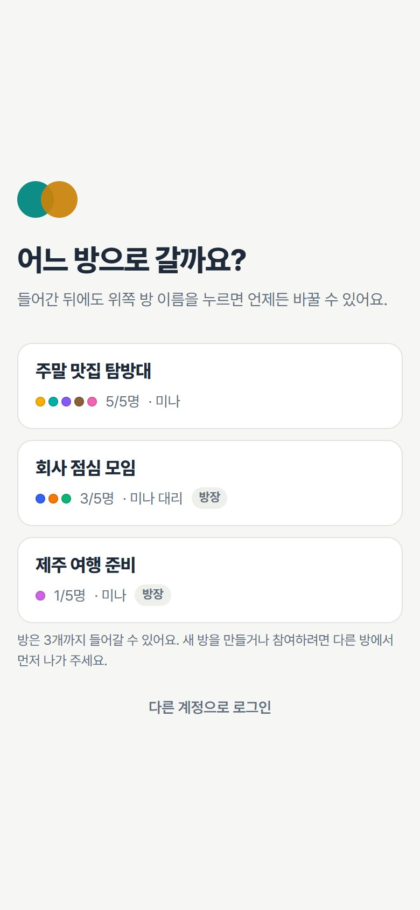
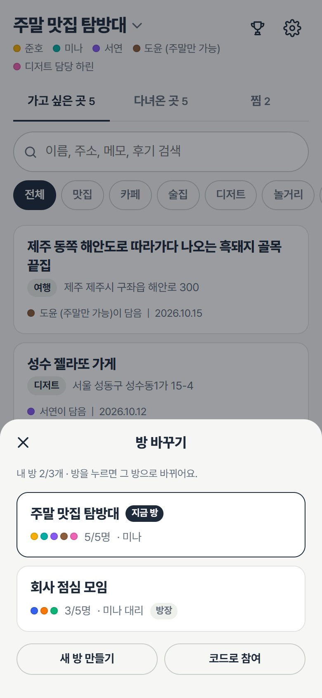
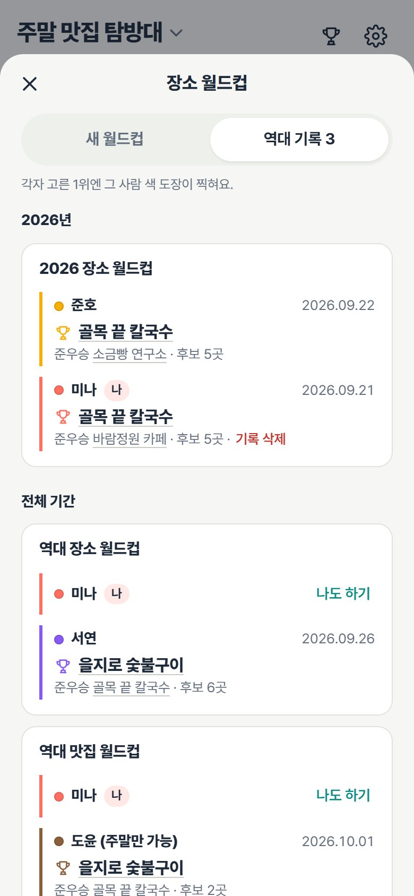
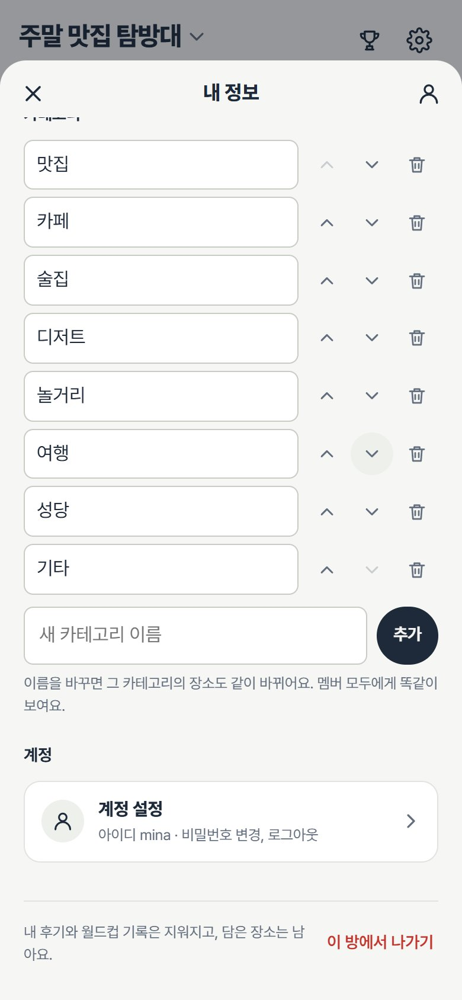
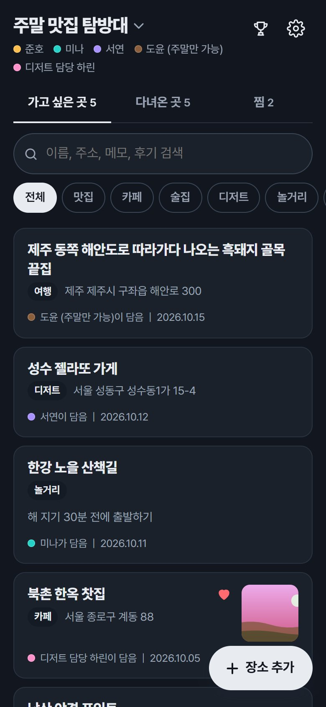
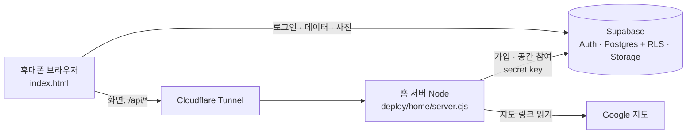

<p align="center">
  
</p>

<h1 align="center">group-place</h1>

<p align="center">
  친구들과 함께 가고 싶은 곳을 모으고, 다녀온 곳엔 방문할 때마다 각자 별점과 후기를 남기는 장소 기록 웹앱
</p>

<p align="center">
  
  
  
  
  
</p>

<p align="center">
  
  
  
  
</p>

> 화면은 예시 데이터로 찍었습니다. 사진은 예시용으로 생성한 이미지이고, 실제 사용자 정보는 들어 있지 않습니다.

## 홍보 영상

<a href="promo/promo-30s.mp4"></a>

30초 세로 영상: [promo/promo-30s.mp4](promo/promo-30s.mp4). 실제 앱 화면을 예시 데이터로 조작해 녹화했습니다(그룹 기능 이전 화면).

## 지금 되는 것

| 기능 | 내용 |
|---|---|
| 방(그룹) | 방 하나에 최대 5명, 한 사람이 최대 3개 방까지. 로그인하면 방을 고르고, 메인 위쪽 방 이름(⌄)을 누르면 누구나 방을 바꾸거나 새 방 만들기·코드로 참여(내 정보에서도 됨). 방 이름은 만들 때 정하고 방장만 바꿈 |
| 멤버 색 | 화사한 무지개 24색 중 방 안에서 겹치지 않게 처음엔 무작위로 정해지고, 내 정보에서 바꿈. 마지막 "직접 고르기"로 색 판이나 색 코드(#RRGGBB)로 아무 색이나 고를 수 있음(다른 멤버 색과 거의 같으면 막고, 비슷하면 알려 줌). 후기·별점·도장에 그 색이 쓰이고, 글씨에는 바탕에서 잘 읽히게 자동으로 진하게(어두운 화면은 밝게) 바꾼 색을 씀 |
| 계정 설정 | 내 정보 맨 아래 "계정 설정"에서 비밀번호 변경·로그아웃·버전 확인. 내 정보에는 방에 관한 것만 |
| 초대 코드 | 첫 멤버가 들어올 때까지 메인 화면에 보이고, 그 뒤로는 멤버 모두가 내 정보에서 확인. 5명이 차 있을 때만 참여가 막힘 |
| 나가기 | 내 정보 맨 아래. 내 후기와 월드컵 기록은 지워지고 담은 장소·사진은 남음. 방장이 나가면 가장 먼저 들어온 멤버가 방장, 마지막 한 명이 나가면 방이 지워짐 |
| 장소 담기 | 이름, 카테고리, 지도 링크, 주소, 함께 쓰는 메모, 사진 최대 10장. 네이버 지도 공유 문구나 구글 지도 링크를 붙여넣으면 이름·주소가 자동으로 채워짐 |
| 세 가지 목록 | 가고 싶은 곳 / 다녀온 곳 / 찜. 검색과 카테고리 필터, 최근 방문·추가·평점순 정렬 |
| 방문 기록 | 같은 곳을 여러 번 가도 방문마다 날짜와 멤버별 별점(0.5점 단위)·후기(닉네임으로 표시) |
| 장소 월드컵 | 연도·카테고리별로 다녀온 곳을 1:1로 골라 최고의 장소 뽑기. 각자 고른 1위에 그 사람 색 도장 |
| 아이디 로그인 | 이메일 없이 아이디 + 비밀번호 (메일을 보내지 않음) |
| 초대 코드 가입 | 관리자가 만든 1회용 가입 코드(`W-XXXX-XXXX`) 또는 방의 8자리 초대 코드로 직접 가입. 틀린 코드는 접속한 곳마다 시간당 5회까지(성공은 세지 않음) |
| 기타 | 다크 모드, 홈 화면에 추가하면 앱처럼 열림, 다른 앱에 다녀오면 최신 내용 다시 불러오기 |

<p align="center">
  
  
  
  
</p>

## 다음에 만들 것

결정 사항과 순서는 [docs/plan.md](docs/plan.md), 그룹 기능 설계는 [docs/groups-design.md](docs/groups-design.md)에 있습니다.

- 공개 방: 만들 때 공개/개인을 정하고(나중에 못 바꿈), 방 선택 화면의 검색으로 공개 방을 찾아 읽기 전용으로 보기
- 앱 이름·아이콘을 그룹용으로, 서버 서비스·경로 이름 정리
- 그다음: 사진 트래픽 줄이기(썸네일), 계정 삭제, 약관·개인정보 처리방침, 안드로이드 앱(TWA)

## 구성



| 영역 | 파일 | 하는 일 |
|---|---|---|
| 화면 | `index.html` | 앱 전체(바닐라 JS, supabase-js v2를 CDN으로). 주소·공개 키 자리는 비워 두고 서버가 보낼 때 채움 |
| 서버 | `deploy/home/server.cjs` | 정해진 파일만 메모리에서 보내고, 설정값을 화면에 넣음. 127.0.0.1에서만 받음 |
| 가입 | `deploy/home/signup.cjs` | `POST /api/signup`, `POST /api/join`. secret key는 이 서버에만 있음 |
| 지도 | `api/place.js` | 구글 지도 링크 → 장소 이름·주소 (로그인한 사람만) |
| DB | `supabase/schema.sql` → `friends-keepalive.sql` → `friends-signup.sql` → `groups.sql` → `colors.sql` | 표, 함수, 권한, RLS, 사진 저장소, 여러 방·5명 규칙, 무지개 24색·직접 고른 색. 순서대로 실행 (되돌리기는 `colors_rollback.sql` → `groups_rollback.sql` 순서, 자세한 것은 `docs/groups-design.md` §6·§10.8) |
| 배포 | `deploy/home/install.sh`, `deploy.ps1`, `*.service`, `*.timer` | 커밋 단위 릴리스, 실패하면 이전 릴리스로 되돌림, 하루 한 번 무료 프로젝트 깨우기 |

## 직접 설치하기

1. **Supabase**: 새 프로젝트를 만들고 SQL Editor에서 `supabase/schema.sql`, `supabase/friends-keepalive.sql`, `supabase/friends-signup.sql`, `supabase/groups.sql`, `supabase/colors.sql`을 차례로 실행합니다. Authentication에서 **Allow new users to sign up은 끕니다**(가입은 서버가 초대 코드를 확인한 뒤 관리자 API로 만듭니다). Site URL에는 앱 주소를 넣습니다.
2. **서버**(Ubuntu, Node 20+): 저장소 맨 위 폴더에서
   ```powershell
   pwsh -File deploy/home/deploy.ps1 -Target <ssh 대상> -SupabaseUrl https://<프로젝트 ID>.supabase.co -SupabaseKey sb_publishable_...
   ```
   서버에서 `install.sh`가 릴리스를 `/srv/our-places/releases/<커밋>`에 풀고 서비스(127.0.0.1:8090)를 시작합니다.
3. **가입 켜기**: Supabase의 secret key를 서버에서 숨김 입력으로 넣습니다.
   ```bash
   ssh -t <ssh 대상> "sudo bash /srv/our-places/current/deploy/home/set-secret.sh"
   ```
4. **공개**: Cloudflare Tunnel 같은 리버스 프록시로 `http://127.0.0.1:8090`을 원하는 주소에 연결합니다.
5. **가입 코드**: `ssh <ssh 대상> "sudo bash /srv/our-places/current/deploy/home/invite.sh new <메모>"`

> 서버 쪽 서비스·경로 이름(`our-places`, `/srv/our-places`, `/etc/our-places`)은 지금 돌고 있는 서버와 맞추려고 그대로 두었습니다. 초기 모델을 배포할 때 `group-place`로 옮길 예정입니다.

## 보안

- 화면에는 **Publishable key**만 들어갑니다. secret key는 서버의 root 전용 설정 파일에만 있고, 저장소·화면·로그·명령줄 인자에는 넣지 않습니다.
- 누가 무엇을 볼 수 있는지는 DB의 RLS 정책으로 막고, 가입·참여는 서버가 코드와 시도 횟수를 확인한 뒤 처리합니다.
- 서버는 설정이 비었거나 자리표시값 그대로이거나, 연결하면 안 되는 프로젝트를 가리키면 시작하지 않습니다.
- 취약점은 [SECURITY.md](SECURITY.md)를 따라 비공개로 알려 주세요.

## 개발

```bash
node --test deploy/home/*.test.cjs      # 가입 API 테스트 (가짜 Supabase)
cd dev/sqltest && npm install && npm test   # SQL 시험: PGlite로 schema.sql → … → groups.sql → colors.sql 실행, 권한·제한·색 확인
node dev/mock/serve.mjs                 # 가짜 Supabase로 화면 띄우기 (dev/mock/shoot.py로 화면 캡처)
bash scripts/leak-check.sh              # 커밋 전 비밀 값·다른 배포 값 검사
git config core.hooksPath .githooks     # 커밋할 때 leak-check 자동 실행
```

## 원래 프로젝트와의 관계

비공개로 운영 중인 2인용 장소 기록 앱에서 출발한 **별도 프로젝트**입니다. 소스 코드와 DB는 완전히 분리되어 있고, 버전도 따로 올립니다. 원래 앱의 개선 사항은 검토해서 이 저장소로 옮겨 오지만, 이 저장소의 내용은 원래 앱으로 가지 않습니다.

## 라이선스

아직 정하지 않았습니다. 정하기 전까지는 저작권자의 허락 없이 복제·배포할 수 없습니다.
